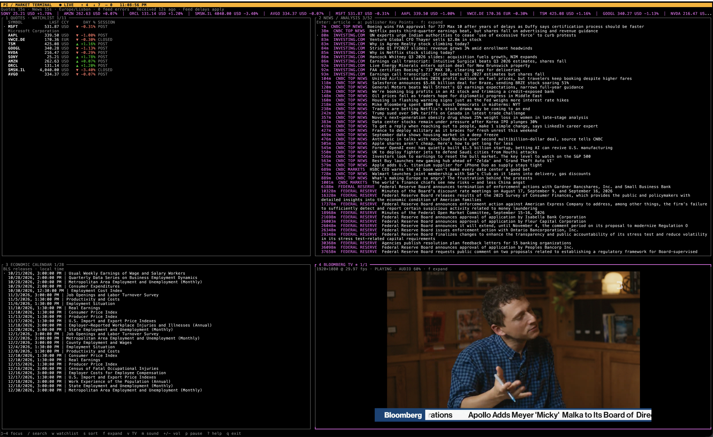

# Pi Market Terminal

A second-screen market workspace for [Pi](https://pi.dev), built for finance professionals, investors and market enthusiasts who spend much of their day in a terminal.

Keep your watchlist, financial news, economic releases and live business television in one keyboard-driven view. Follow what is moving, open a source when a headline matters, and return to your work without maintaining a wall of browser tabs.



_Real UI screenshot supplied by the author. Prices, headlines and broadcast content reflect the captured session; they are not current market data._

## Why it exists

Market monitoring is often split across a watchlist app, several news pages, a calendar and a live broadcast. This extension brings that monitoring workflow into the same terminal environment as Pi. The goal is a useful, inspectable second-screen companion for research and market awareness, with clear source attribution and honest data freshness.

It takes visual inspiration from professional financial terminals while using public data sources. It does not connect to a broker or execute trades. Background updates do not invoke an AI model or consume model tokens.

## What you get

- **Watchlist:** prices, trading currency, session state, daily change, source timestamps and stale-data indicators. Sort by watchlist order, gainers or losers.
- **News:** publisher-labelled headlines with relative age, local search, public article reading and attributed CNBC Key Points where available.
- **Economic calendar:** upcoming official U.S. Bureau of Labor Statistics releases, shown in your local timezone.
- **Live TV inside the terminal:** local Kitty uses mpv to play the best available Bloomberg YouTube source up to 1080p, with audio, mute, volume and pause controls.
- **Instrument details:** open a quote for an on-demand one-month daily-close chart, date range, low/high and period change.
- **Terminal workflow:** rotating ticker tape, in-dashboard watchlist editing, expandable panes, source-health diagnostics and keyboard help.

## Install

Requires Node.js **22.19+** and Pi. The release is tested with Pi **1.3.0**. macOS with Kitty is the validated video setup; Linux has not yet been validated. In-pane mpv video is not supported on Windows, SSH, tmux or screen in this release.

### Install from Git

```sh
pi install git:github.com/PRELVAS94/pi-market-terminal@v0.8.1
```

Start a fresh Pi session, or close an old dashboard and run `/reload`, then:

```text
/market-terminal
```

### npm and the official Pi gallery

The package includes the official `pi-package` discovery keyword, an extension manifest and a screenshot preview. After its first npm publication, it can be installed with:

```sh
pi install npm:pi-market-terminal
```

Gallery eligibility follows [Pi's package documentation](https://pi.dev/docs/latest/packages). Publishing and indexing are separate steps; a gallery listing does not imply endorsement by Pi maintainers.

### Enable TV

For the tested macOS setup:

```sh
brew install --cask kitty
brew install mpv yt-dlp ffmpeg
```

Open **Kitty directly**, start Pi and open the dashboard. mpv and yt-dlp enable the in-terminal 1080p route; FFmpeg enables the portable preview fallback. Programs are discovered on PATH and in standard Homebrew locations. The extension does not install external programs for you.

A window around **160 columns × 48 rows** gives the four panes room to breathe; 80 × 24 is supported. Focus TV with `4`, expand with `f`, and enable sound with `m`. Playback starts muted. A small pane scales the source down: displaying every pixel of a 1920×1080 source requires that much physical display space.

## Keyboard

| Key                         | Action                                                    |
| --------------------------- | --------------------------------------------------------- |
| `1`–`4`, `Tab`, `Shift+Tab` | Change focused pane                                       |
| `↑` / `↓`                   | Select an item or scroll details                          |
| `Enter`                     | Open quote/article/event details; toggle TV in pane 4     |
| `f`                         | Expand or restore the focused pane                        |
| `/`                         | Search loaded symbols, company names and headlines        |
| `w`                         | Edit the watchlist; Enter saves, Escape cancels           |
| `s`                         | Cycle watchlist, gainers and losers                       |
| `t`                         | Cycle quote polling: 5, 15 or 60 seconds                  |
| `v`                         | Start, stop or retry terminal TV                          |
| `m`, `+`, `-`               | Mute/unmute TV and adjust volume                          |
| `g`                         | Switch to a separate maximum-quality mpv window           |
| `p`                         | Pause/resume feeds and playback                           |
| `r`                         | Refresh feeds, respecting error cooldowns                 |
| `h`                         | Source health and retry deadlines                         |
| `a`                         | Toggle CNBC publisher Key Points while reading an article |
| `o`                         | Open the selected source or TV in your browser            |
| `?`                         | Show keyboard help                                        |
| `Esc`                       | Back, clear search or close                               |
| `q`                         | Close the dashboard and its players                       |

While an input field is open, keys edit its text until Enter/Escape. Submit an empty search, or press Escape, to clear a filter.

## Configure your workspace

```text
/ticker set MSFT AAPL NVDA VWCE.DE
/ticker add TSM
/ticker remove AAPL
/ticker every 15
/ticker-news sources set cnbc-markets cnbc-top fed
/ticker-news filter rates
/ticker-news filter off
/ticker-news every 15
```

Only three slash commands are registered: `/market-terminal`, `/ticker` and `/ticker-news`. Settings persist within the current Pi session and are restored when that session resumes. Fresh sessions use the default watchlist and 15-second quote/news intervals. The maximum watchlist is 20 symbols.

Default watchlist: MSFT, AAPL, VWCE.DE, TSM, GOOGL, NVDA, SONY, AMZN, ORCL, SMSN.IL and AVGO. These are example instruments, not recommendations. Use full Yahoo symbols to choose an exchange/listing. `vwce` resolves to VWCE.DE (EUR, Xetra); `smsn` and `samsung` resolve to SMSN.IL (USD, London GDR).

Available news sources: `cnbc-markets`, `cnbc-top`, `fed`, `investing`, `wsj-markets`, `ft`.

## How it works

A shared scheduler polls quotes and news once per symbol/source within a Pi process. Quotes have a five-second cache; failures retain the last successful value and trigger exponential backoff. The tape rotates cached data rather than causing requests. Search and sorting operate on downloaded content. Charts and public article bodies load only when opened.

Kitty video runs in an mpv child process. A private inherited JSON IPC pipe controls pause, mute and volume. A bounded bridge accepts shared-memory graphics packets, normalizes POSIX memory names for Kitty, and assigns its own image ID and pane placement. It discards mpv's screen-clearing, cursor, mouse and delete-all commands so the rest of Pi stays in control. Resizing changes placement without restarting the stream. Closing the view stops the processes and frees owned images.

Other graphics-capable terminals retain a 640×360 silent preview at 6 fps, or a 2 fps character fallback on text-only terminals. `g` and `o` provide separate-player and browser alternatives.

The `market_data`, `market_news` and `market_article` tools let Pi use the same sources when you explicitly ask for analysis. CNBC Key Points in the dashboard remain publisher content; viewing them does not invoke Pi analysis.

## Data boundaries

Yahoo quotes and RSS feeds can be delayed, rate-limited, blocked or temporarily unavailable. Polling every five seconds does not make the underlying quote exchange-grade real-time data. Source quote time and retrieval age are separate. Faster polling can increase provider load; 15 seconds is the default.

The calendar currently covers BLS releases only, not earnings or FOMC. The chart is a daily-close series, not an intraday chart; its last point may reflect an incomplete session. Article text may be partial, and premium/blocked pages retain the supplied excerpt and source link. No subscription content is unlocked.

No holdings, balances or brokerage credentials are stored. The extension makes direct requests to configured public providers and launches the optional local players. No extension analytics service is used.

## Development and contribution

```sh
git clone https://github.com/PRELVAS94/pi-market-terminal.git
cd pi-market-terminal
npm ci --ignore-scripts
npm run check
npm test
```

The optional macOS graphics integration test uses real mpv and Kitty's native parser, without opening a desktop window:

```sh
npm run test:kitty
```

It verifies non-black 1920×1080 frames, successful graphics acknowledgments, one placement and image cleanup. Set `PI_TEST_KITTY` if Kitty is installed elsewhere.

See [architecture](docs/architecture.md), [contributing](CONTRIBUTING.md), [release instructions](docs/publishing.md) and [changelog](CHANGELOG.md). Contributions around provider resilience, accessibility, additional calendar coverage and measured cross-platform video support are welcome.

## License and credits

Extension code is [MIT licensed](LICENSE), authored by [Pedro Relvas](https://github.com/PRELVAS94). Built on Pi's extension and terminal UI APIs, with video provided by mpv, yt-dlp and FFmpeg.

The screenshot includes third-party data and broadcast imagery; that content and third-party names/logos remain their respective owners'. This is an independent community extension, with no affiliation with or endorsement by Bloomberg, CNBC, Yahoo or Pi maintainers.
